# Sentiment Analysis with RNN, LSTM and GRU

This project compares an order-blind ANN baseline with recurrent neural-network models for binary sentiment classification on the Kaggle IMDB movie-review dataset.

## Models Covered

- ANN baseline (Embedding → Flatten → Dense)
- SimpleRNN
- LSTM
- Stacked LSTM
- GRU

## Main Workflow

1. Load `IMDB Dataset.csv` and inspect the review/sentiment columns.
2. Remove duplicate reviews and clean text while preserving apostrophes and negation.
3. Analyze review lengths and sentiment distribution.
4. Create a stratified 80/20 train/test split.
5. Fit a tokenizer on training text only and pre-pad sequences.
6. Train and evaluate ANN, SimpleRNN, LSTM, Stacked LSTM and GRU.
7. Compare training time, parameter counts, classification metrics, gradient flow, ROC curves, and accuracy by review length.
8. Analyze false positives/false negatives and run custom text predictions.

## Repository Structure

```text
DL_PR5/
├── DL_PR5(1).ipynb
├── README.md
├── requirements.txt
├── IMDB Dataset.csv        # Download separately from Kaggle
└── assets/
    └── notebook-output-*.png
```

## Dataset Required

Download the Kaggle **IMDB Dataset.csv** and place it in the same folder as the notebook. The notebook explicitly expects the CSV and does not use `keras.datasets.imdb`.

Expected columns:
- `review`
- `sentiment`

The dataset is not bundled in this package.

## Installation

Python 3.10 or newer is recommended. Create a virtual environment if desired, then install dependencies:

```bash
python -m venv .venv
.venv\Scripts\activate
python -m pip install --upgrade pip
pip install -r requirements.txt
```

## Run the Notebook

```bash
jupyter notebook
```

Open `DL_PR5(1).ipynb`, ensure `IMDB Dataset.csv` is in the same folder, and run the cells in order. TensorFlow model training can take time depending on CPU/GPU and dataset size.

### ▶️ Video Demonstration

> **Project Explanation Video:**  
> [Click here to watch the complete project explanation](https://drive.google.com/file/d/1xjQKy0JYcfzEIoNeaH3h0U_3cIlNb4Z1/view?usp=sharing)


## Images / Notebook Outputs

The following gallery contains all **16 embedded image outputs** found in the uploaded notebook. They are extracted into `assets/` and referenced using relative paths so the images can display on GitHub.
### accuracy_by_hidden_units.png

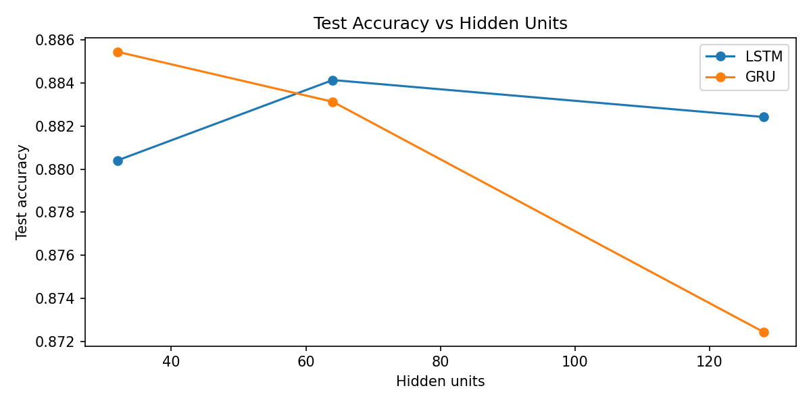
### accuracy_by_length.png

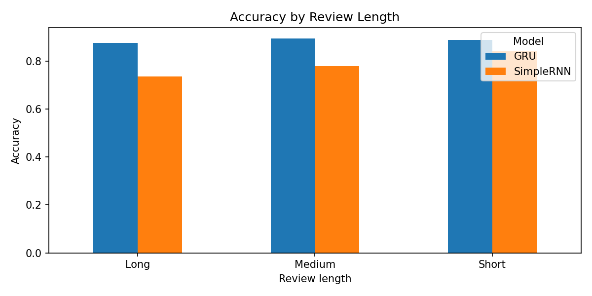
### accuracy_vs_sequence_length.png

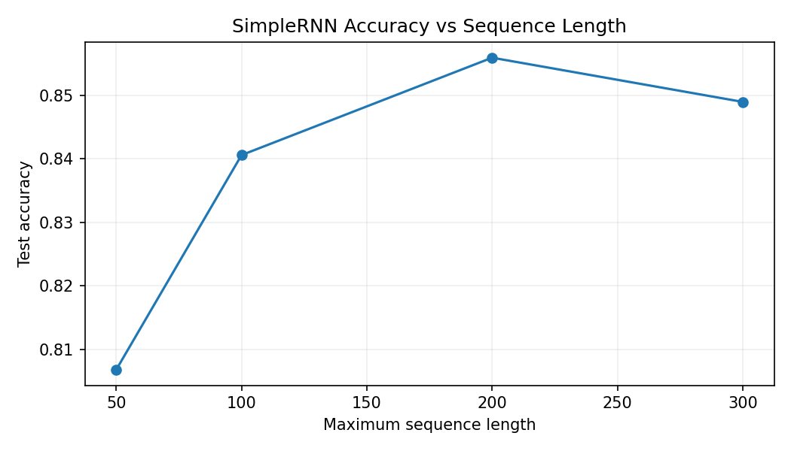
### cm_simplernn.png

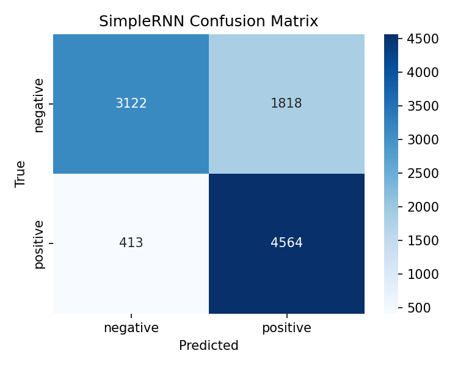
### exploding_gradient_clipping.png

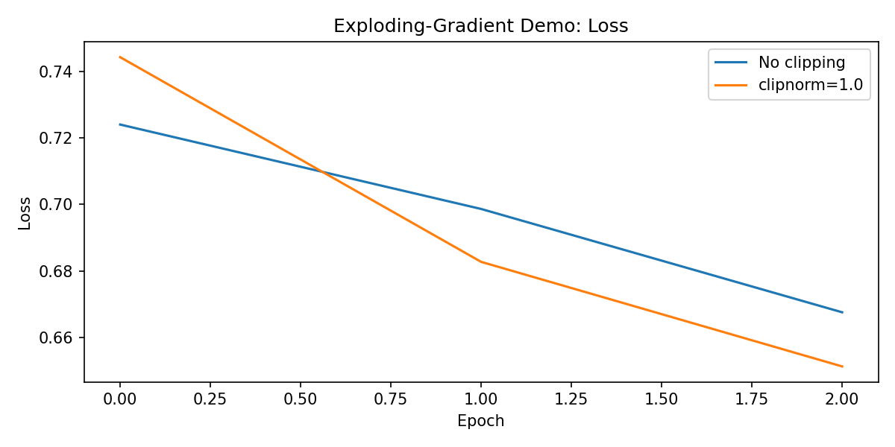
### gradient_norms_rnn_lstm.png

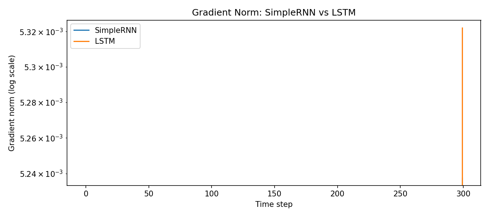
### gradient_norms_simplernn.png

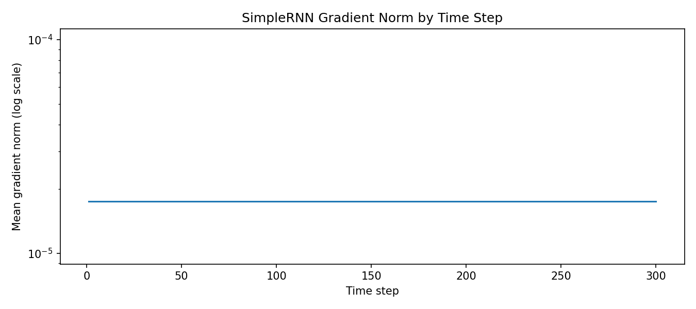
### gradient_norms_snn_lstm_gru.png

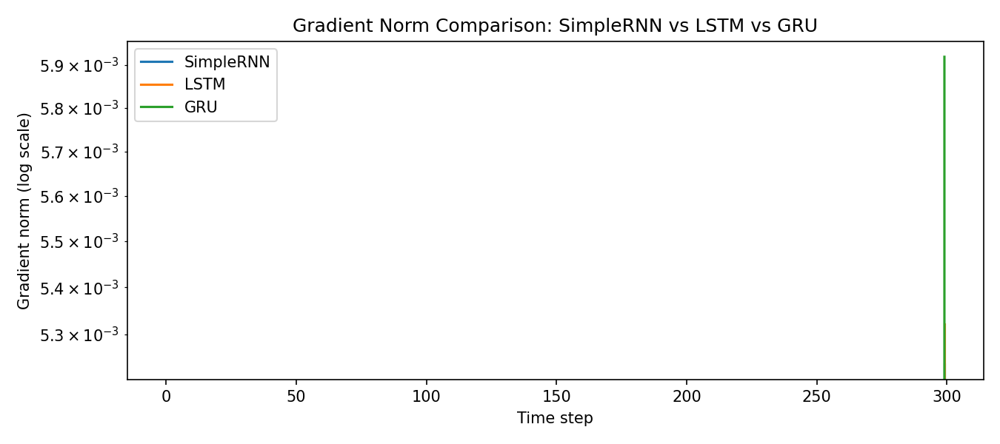
### length_boxplot.png

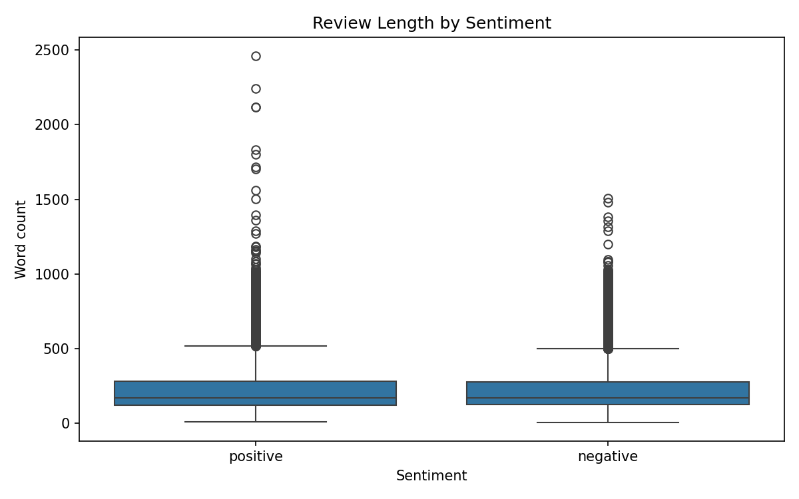
### length_distribution.png

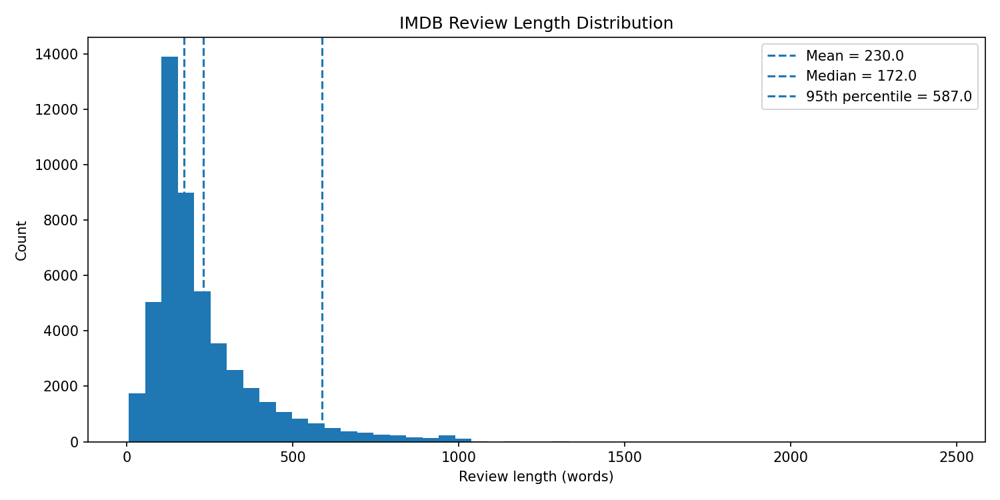
### manual_forward_heatmap.png

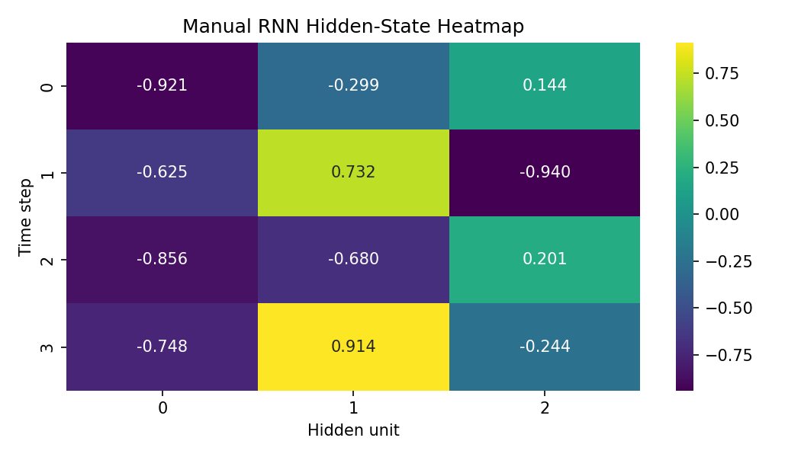
### parameters_by_hidden_units.png

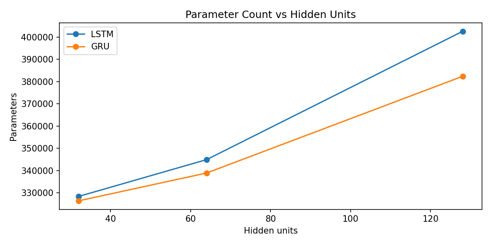
### roc_curves.png

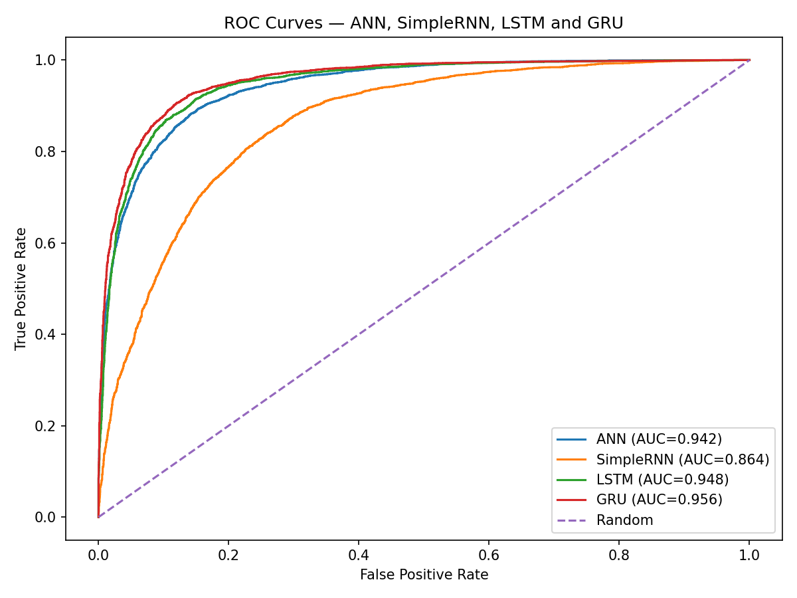

## Troubleshooting

- **`FileNotFoundError: IMDB Dataset.csv was not found`**: download the Kaggle CSV and place it beside the notebook.
- **Missing package errors**: activate the project environment and run `pip install -r requirements.txt`.
- **TensorFlow training is slow or runs out of memory**: reduce batch size, sequence length, vocabulary size, or epochs in the notebook configuration.
- **Images do not display on GitHub**: keep the `assets/` folder in the same repository as `README.md`; do not rename the referenced image files.

## Technologies

Python · TensorFlow/Keras · NumPy · Pandas · Matplotlib · Seaborn · scikit-learn · Jupyter Notebook

## Author

Update with your name, college, department, semester, and submission details.
